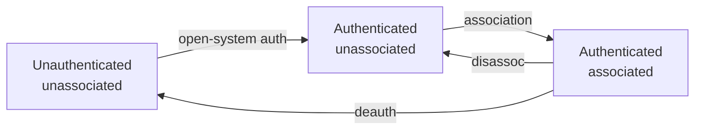

# 01.4 · Joining a network — beacons, probes, authentication, and association

Joining a Wi-Fi network is a specific, observable sequence of management frames, and once you can trace it you can read almost any capture and spot where something was injected, forged, or went wrong. This lesson walks the client through discovery, open-system authentication, and association into a BSS, keeps the legacy "authentication" step clearly separated from the real security handshake that comes later, and offers both a recorded-data trace and a virtual-radio lab where you watch a genuine join happen with no hardware.

## Why this matters

The recon, rogue-AP, and handshake-capture work later in the course all key off this sequence: a deauth attack interrupts it, an evil twin imitates the beacon/probe step, and the WPA2/WPA3 handshake happens *after* association. If the join sequence is clear in your head, those attacks are variations you can predict rather than memorise. Tracing the state machine in a capture is also the cleanest way to confirm your own lab client actually associated with your own AP — containment you can verify frame by frame.

## Learning objectives

- Describe the **discovery → authentication → association** sequence a client follows to join a BSS.
- Distinguish **passive vs active scanning**, and **open-system authentication** from the later **security handshake**.
- Trace the **join state machine** in a capture, and on the virtual path watch a real join occur.

## Prerequisites

- [01.3 · The 802.11 frame](lesson-03.md) — you must be able to read management-frame subtypes and addressing to follow the join.

## Concept

### How it works on the wire

A client joins a **BSS** (one AP's cell, identified by its **BSSID**) in three stages. Several APs sharing one SSID form an **ESS**, which is what lets a client roam between them under a single network name.

**1. Discovery (scanning).** The client finds candidate networks two ways:

- **Passive scanning** — the client listens on each channel for **beacon** frames, which the AP broadcasts periodically (commonly ~10 times/second) advertising its SSID, supported rates, channel, and security capabilities (the RSN information element). Passive scanning transmits nothing from the client.
- **Active scanning** — the client sends **probe request** frames (broadcast, or naming a specific SSID) and APs reply with **probe responses**. Active scanning is faster but makes the client transmit, and the SSIDs it probes for can reveal its **Preferred Network List** — a fact that matters for KARMA/MANA and evil-twin viability in Module 9.

**2. Authentication (the legacy step).** The client sends an **authentication** frame and the AP replies. For modern WPA2/WPA3-Personal networks this is **Open System** authentication — a two-frame formality that authenticates *nothing* and always succeeds. It is a historical artifact of the state machine, not the security mechanism.

> [!IMPORTANT]
> Do not confuse 802.11 **open-system authentication** with the real security handshake. The actual key agreement — the WPA2/WPA3 **4-way handshake** (or SAE for WPA3) — happens **after association**, carried in EAPOL data frames (Module 6). A capture that shows "Authentication, Success" has not shown you any cryptography.

**3. Association.** The client sends an **association request** (listing its capabilities and chosen security parameters); the AP replies with an **association response** carrying a status code and, on success, an **Association ID (AID)**. Only now is the client a member of the BSS. For a secured network, the 4-way handshake follows immediately to derive the session keys before data can flow.

### The join state machine

IEEE 802.11 models the relationship as states the client moves through:

1. **Unauthenticated, unassociated** — the start; the client has heard beacons/probe responses but joined nothing.
2. **Authenticated, unassociated** — open-system authentication done (the formality above).
3. **Authenticated, associated** — association succeeded; for an open network, data can flow; for a secured one, the handshake runs next to unlock encryption.

A **deauthentication** frame kicks the client back toward state 1, and a **disassociation** frame drops it from associated to merely authenticated — which is exactly why those two management frames are the lever behind deauth attacks (Module 6) and why management-frame protection (PMF, Module 12) matters.



### Where the security handshake fits

To keep the sequence honest end to end for a WPA2-Personal network: beacon/probe (discovery) → open-system authentication (formality) → association → **4-way handshake** (the real cryptography, Module 6) → encrypted data. WPA3-Personal replaces the handshake stage with **SAE** and requires PMF, but the discovery/auth/association scaffolding is the same. Seeing that scaffold in every capture is the point of this lesson.

Step through the exchange interactively (educational model):

[Simulation: 802.11 join and frame exchange](../../simulations/wifi-join/index.html)

## Hands-on

This lesson supports two paths. **R** proves you can *read* a join from a capture; **V** proves you can *reproduce* the protocol flow with simulated radios — neither proves anything about real RF, drivers, or injection (that is the physical path, later).

### Guided walkthrough — trace a join in a supplied capture (path R)

1. From the module zip (`labs/module-01/`), open `captures/join-sequence.pcapng` in Wireshark.
2. Filter for management frames and find, in order: a **beacon**, the client's **probe request** and the AP's **probe response**, the two **authentication** frames, and the **association request/response**.
3. For each, confirm the addressing from [lesson 01.3](lesson-03.md): which MAC is the client, which is the BSSID.
4. Note where the **EAPOL** 4-way handshake frames begin — *after* the association response — and confirm that the "authentication" frames carried no keys.

### Lab — watch a real join on simulated radios (path V)

> [!NOTE]
> **Lab paths:**
> R (read the supplied `join-sequence.pcapng` — no hardware; proves you can interpret the join sequence, not that you captured it).
> V (`mac80211_hwsim` + `hostapd` + `wpa_supplicant` in a Linux VM — proves you can reproduce and observe the discovery/auth/association flow end to end; does **not** reproduce real RF, drivers, range, interference, or monitor/injection behaviour).
> **Start state (V):** a Linux VM; `mac80211_hwsim`, `hostapd`, `wpa_supplicant`, `iw` installed (see `TOOLS.md`); no over-the-air transmission occurs.
> **Duration:** ~25 min (V) / ~10 min (R).
> **Artifacts:** (R) an annotated list of the join frames in order; (V) `hostapd`/`wpa_supplicant` logs showing authentication and association, and an `iw dev <phy> link` line confirming the client associated to your simulated BSSID.
> **Cleanup (V):** stop `hostapd`/`wpa_supplicant`, run `labs/common/hwsim-down.sh` to remove the simulated radios. Nothing was transmitted over the air, so there is no RF cleanup.

Virtual-path outline (full, pinned steps are in `labs/module-01/README.md`):

```bash
sudo ./labs/common/hwsim-up.sh          # load mac80211_hwsim -> two simulated radios (wlan0, wlan1)
sudo hostapd hostapd-open.conf          # bring up an OPEN lab BSS on wlan0 (SSID: LAB-JOIN)
sudo wpa_supplicant -i wlan1 -c join.conf -d   # client joins; watch auth then assoc in the log
iw dev wlan1 link                       # confirm "Connected to <BSSID>"
sudo ./labs/common/hwsim-down.sh        # cleanup
```

> [!NOTE]
> **LAB TARGET vs REAL NETWORK:** the virtual BSS exists only inside the kernel's simulated radios — it has no antenna and radiates nothing. The SSID `LAB-JOIN` and any credentials are synthetic. This is the containment-friendly way to study joins ([00.3](../module-00/lesson-03.md)).

## Exercise

A learner captures a join and reports: "The client authenticated successfully, so the network accepted its password." Explain what is wrong with that conclusion, name the frames that *actually* prove the password was involved, and say where in the sequence they appear.

<details>
<summary>Hint</summary>

What kind of "authentication" does a modern WPA2/WPA3 network use at the 802.11 layer, and what does it actually verify? Then recall where the real key agreement lives relative to association, and which frame type carries it.
</details>

<details>
<summary>Reference answer</summary>

On a modern WPA2/WPA3-Personal network the 802.11 "authentication" frames are **Open System** — a two-frame formality that always succeeds and verifies no password at all. So "authenticated successfully" proves only that the state machine advanced, not that any credential was checked. The password is involved in the **4-way handshake** (WPA2) or **SAE** (WPA3), carried in **EAPOL data frames** that appear **after the association response**. If those complete, the client proved it holds the key; if the passphrase were wrong, association might still show success while the handshake fails. The learner should point to the post-association EAPOL exchange, not the authentication frames.
</details>

## References

- IEEE 802.11-2020 — scanning, authentication, association, and the client state machine (`../../references/README.md`).
- [Linux `mac80211_hwsim`](https://www.kernel.org/doc/html/latest/networking/mac80211_hwsim/mac80211_hwsim.html) — the simulated radios used by the virtual lab.
- [01.3 · The 802.11 frame](lesson-03.md) — the management-frame subtypes and addressing you traced here.

## What you should now be able to do

- Describe the discovery → authentication → association sequence and the BSS/ESS it joins.
- Distinguish passive from active scanning, and open-system authentication from the later security handshake.
- Trace the join state machine in a capture and, on the virtual path, reproduce and observe a real join with no hardware.
