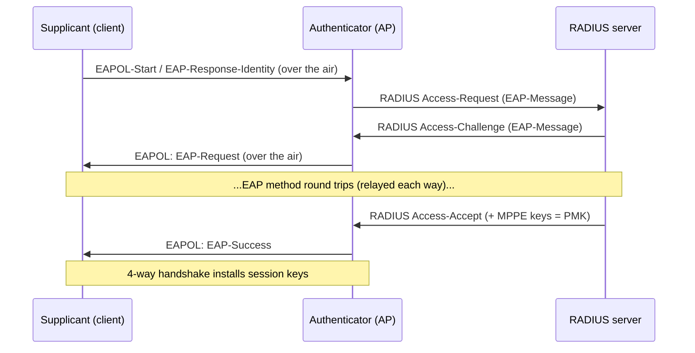

# 10.1 · 802.1X — supplicant, authenticator, and RADIUS

Enterprise Wi-Fi throws away the one secret everyone shares and replaces it with a conversation between three parties: the client proving an individual identity, the access point relaying that proof, and a back-end server deciding whether to believe it. This lesson introduces 802.1X as that three-role framework — supplicant, authenticator, and authentication server (RADIUS) — shows how an EAP exchange is carried from EAPOL on the air to RADIUS on the wire and back, and pins down exactly where trust lives, because every enterprise attack and defence in the next module turns on that one question.

## Why this matters

A WPA2-Personal network has a single point of failure you already know how to attack: the shared passphrase. Enterprise Wi-Fi removes it entirely — there is no group secret to capture and crack offline (you proved this in [02.1](../module-02/lesson-01.md): the enterprise PMK comes from the authentication exchange and is effectively random). That changes the whole shape of the engagement. You are no longer hunting a crackable handshake; you are reasoning about identities, a server the client is supposed to verify, and the trust relationship between an AP and a RADIUS server. If you do not have the three roles and the relay straight, everything in the attack module (credential capture, relay, the rogue RADIUS server a hardened client refuses) will be a blur. This lesson is the map you will navigate by for the rest of the enterprise sequence, and it is the architecture you will actually build in [10.3](lesson-03.md).

## Learning objectives

- Name the three 802.1X roles — **supplicant**, **authenticator**, **authentication server** — and state what each is responsible for.
- Describe the EAPOL-to-RADIUS relay: how the authenticator passes EAP between the air-side and the server-side without understanding the method.
- Explain where trust lives in enterprise Wi-Fi (the server certificate and the AP↔RADIUS shared secret) and how that differs from a shared PSK.

## Prerequisites

- [02.1 · The protocol family — Open, OWE, WPA2, WPA3, Enterprise, and PMF](../module-02/lesson-01.md) — you can already recognise the 802.1X AKM selector in a beacon and know that Enterprise authenticates an individual identity rather than a shared passphrase.

## Concept

### The three roles

802.1X (IEEE 802.1X, "port-based network access control") defines three roles. On Wi-Fi they map cleanly:

- **Supplicant** — the client that wants on the network and must prove who it is. On Linux this is `wpa_supplicant`; on a laptop or phone it is the OS's built-in 802.1X client. It holds the user's identity and credentials and — crucially — is responsible for **validating the server** before it hands anything over.
- **Authenticator** — the access point. It controls the "port" (the association) and will not pass general traffic until authentication succeeds. The decisive thing to understand: the authenticator does **not** decide whether you pass. It is a relay and a gatekeeper, not the judge.
- **Authentication server** — a **RADIUS** server (for example FreeRADIUS) sitting on the wired side. It runs the actual EAP method, checks the identity against its user store or a certificate, and returns the verdict. When it says "accept," it also delivers the keying material the AP needs.

Compare this with WPA2-PSK, where the AP *is* the judge: it holds the one passphrase and verifies the 4-way handshake itself. In enterprise, the AP deliberately knows no user credentials at all.

### How it works on the wire — the EAPOL-to-RADIUS relay

The client and the server need to run an EAP method (next lesson) end to end, but they are on two different link types — 802.11 on one side, Ethernet/IP on the other — and the AP sits in the middle. 802.1X solves this by having the authenticator **relay** EAP across the boundary:

1. The supplicant associates to the AP as usual, but the "port" stays closed to ordinary traffic. Only **EAPOL** (EAP over LAN, the same ethertype that carries the 4-way handshake) is allowed through.
2. The AP and supplicant exchange **EAPOL-Start / EAP-Request-Identity / EAP-Response-Identity** over the air.
3. The AP takes each EAP message off the air and **re-wraps it inside a RADIUS packet** (`Access-Request`, with the EAP payload in the `EAP-Message` attribute) sent to the RADIUS server over the wired network.
4. The server replies with RADIUS `Access-Challenge` packets carrying the next EAP message; the AP unwraps each one and sends it back to the supplicant as EAPOL. This ping-pong continues for as many round trips as the EAP method needs.
5. When the method finishes, the server sends `Access-Accept` (or `Access-Reject`). On accept, the RADIUS packet also carries the **MPPE keys** — the master session key derived by the EAP method — which become the PMK. The AP and client then run a normal 4-way handshake to install fresh session keys.

The point worth repeating: **the authenticator never interprets the EAP method.** It shuttles opaque EAP blobs between EAPOL and RADIUS. That is why the same AP can broker PEAP, EAP-TTLS, or EAP-TLS without any method-specific configuration — and why the client's trust decision cannot be delegated to the AP.

### Where trust lives

In WPA2-PSK, trust is one symmetric secret: whoever knows the passphrase is trusted, in both directions, and that is the whole model. Enterprise splits trust into two distinct relationships, and knowing them is the hinge for the entire attack/defence module:

- **Between the AP and the RADIUS server:** a **shared secret** configured on both ends, plus (normally) the two being on a trusted wired segment. This is what lets the server believe an `Access-Request` really came from a legitimate AP, and the AP believe the `Access-Accept`.
- **Between the supplicant and the RADIUS server:** a **certificate**. Every modern EAP method runs inside a TLS tunnel, and the server presents a certificate. The client is supposed to **validate that certificate** — is it issued by a CA I trust, and does the name match the server I expect? — *before* sending any credential inside the tunnel. When a client skips that check, it will happily tunnel its credentials to **any** server, including an attacker's. That single missing check is the root of the enterprise credential-capture attack you will study in Module 11.

So "where does trust live?" has a precise enterprise answer: in the **server's certificate** (validated by the client) and in the **AP↔RADIUS shared secret** — not in any secret shared with other users. There is nothing for a passive attacker to capture and crack offline; the attack surface moves to *whether the client actually checks the certificate*.

## Hands-on

This is a reading-and-reasoning lesson on the recorded path — no radio, no server yet (you build the real thing in [10.3](lesson-03.md)). You trace a real enterprise authentication in a supplied capture and name each role and relay step.

### Guided walkthrough — follow an EAP conversation across the relay

Using the supplied capture in `../../labs/module-10/` opened in Wireshark (display filters only; Module 5 covered the tool):

1. Open `enterprise-eap-success.pcapng`. This capture contains the **air-side** (EAPOL) view of a successful enterprise authentication.
2. Apply the filter `eapol` to isolate the 802.1X frames. Find the **EAP-Request/Identity** from the authenticator and the **EAP-Response/Identity** from the supplicant. Note the identity string the client sends in the clear.
3. Follow the EAP exchange frame by frame. Notice you can see EAP *request/response* pairs but, once the TLS tunnel starts, the method's inner content is encrypted — you see the tunnel, not the credentials.
4. Find the final **EAP-Success** frame, then the four **EAPOL-Key** frames (the 4-way handshake) that follow it. This is the moment the relayed RADIUS `Access-Accept` has delivered the PMK and the AP installs session keys.
5. On paper, label each step with the role that produced it (supplicant / authenticator) and write, for the two tunnelled portions, *why* you cannot read them.

### Lab

> [!NOTE]
> **Lab paths:** R — supplied air-side capture of a successful enterprise authentication, no hardware (proves you can *interpret* the 802.1X roles and the EAP exchange). This lab does **not** prove live capture, injection, RADIUS configuration, or any RF behaviour — you build and run a real RADIUS server on the V path in [10.3](lesson-03.md).
> **Start state:** `enterprise-eap-success.pcapng` from the module zip, Wireshark installed, no lab network built.
> **Duration:** ~20 min.
> **Artifacts:** an annotated frame list — identity request/response labelled by role, the point where the TLS tunnel begins, the `EAP-Success` frame, and the four `EAPOL-Key` handshake frames — plus a one-line note on where trust lives in what you observed.
> **Success criteria:** you can point to each of the three roles' contributions in the capture and explain why the relayed RADIUS side is not visible in an air-side capture.
> **Troubleshooting:** no `eapol` frames shown → confirm the filter and that you opened the enterprise capture, not a WPA2-PSK one; cannot see inner method → that is expected, the TLS tunnel protects it; no handshake after `EAP-Success` → scroll past the `EAP-Success`, the four `EAPOL-Key` frames come immediately after.
> **Cleanup:** none (read-only analysis).

> [!NOTE]
> **LAB TARGET vs REAL NETWORK:** the capture was generated on owned lab equipment with a synthetic identity (`labuser@lab.local`) and synthetic credentials. Never capture or analyse authentication traffic from a network you do not own or are not authorised to test.

## Exercise

A junior tester inspects an enterprise Wi-Fi authentication and reports: "The access point checked the user's password against its database and let them on, so to attack this I need to crack the password out of the capture like we did for WPA2-PSK." Identify every misconception in that sentence, and rewrite it as an accurate description of who decides, what is (and is not) in the capture, and where an attacker would therefore focus.

Hint

Two separate errors are bundled together. First, *who* makes the accept/reject decision in 802.1X — is it the AP or something behind it? Second, *what the capture contains* — is there an offline-crackable passphrase hash on the wire the way a WPA2-PSK handshake is, given the credentials travel inside a TLS tunnel and the PMK is effectively random?

Reference answer

Both claims are wrong. The **AP does not check anything** — it is the authenticator, a relay that re-wraps EAP between EAPOL and RADIUS; the **RADIUS authentication server** runs the EAP method and makes the accept/reject decision, and the AP holds no user credentials. And there is **no WPA2-style crackable secret in this capture**: the credentials are exchanged inside a TLS tunnel, and the enterprise PMK is derived from the EAP method and is effectively random, so there is nothing to feed a wordlist the way a captured 4-way handshake can be. An accurate rewrite: "The supplicant proved an identity to a back-end RADIUS server through a TLS-tunnelled EAP method, relayed by the AP; the server decided and delivered the PMK. There is no offline-crackable passphrase here. An attacker would instead target **whether the client validates the server's certificate** — if it does not, a rogue RADIUS server can trick it into tunnelling its credentials to the attacker (Module 11)."

## References

- [RFC 3748 — Extensible Authentication Protocol (EAP)](https://www.rfc-editor.org/rfc/rfc3748) — the EAP framework the relay carries.
- [IEEE 802.1X-2020 — Port-Based Network Access Control](https://standards.ieee.org/ieee/802.1X/7345/) — supplicant / authenticator / authentication server roles and the controlled port.
- [RFC 2865 — RADIUS](https://www.rfc-editor.org/rfc/rfc2865) — the `Access-Request` / `Access-Challenge` / `Access-Accept` exchange and the `EAP-Message` attribute.
- [02.1 · The protocol family](../module-02/lesson-01.md) — the 802.1X AKM selector and why the enterprise PMK is not crackable.
- Glossary: 802.1X, EAP, EAPOL, RADIUS, supplicant, authenticator (`../../glossary.md`).

## What you should now be able to do

- Name the supplicant, authenticator, and authentication server, and say which one actually decides whether a client is admitted.
- Trace an EAP conversation across the EAPOL-to-RADIUS relay and explain why the AP never interprets the method.
- State where trust lives in enterprise Wi-Fi — the server certificate the client must validate, and the AP↔RADIUS shared secret — and how that differs from a shared PSK.
