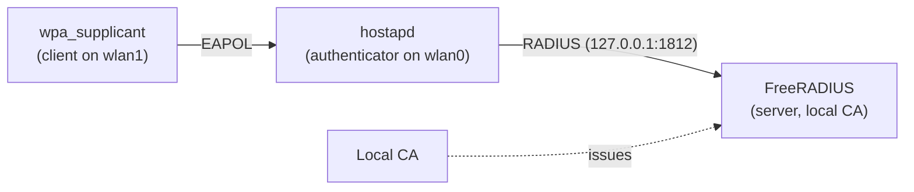

# 10.3 · Build the lab — CA, FreeRADIUS, supplicant, and a client profile

This is where the architecture from the last two lessons becomes a network you can log in to: a local certificate authority, a FreeRADIUS server holding a correctly-issued server certificate, hostapd acting as the authenticator on a simulated radio, and a wpa_supplicant client profile that validates the server and authenticates with PEAP. By the end you will have watched a real EAP authentication succeed and read the accept in the RADIUS log — the working enterprise network you will attack, then harden and retest, in the next module.

> [!NOTE]
> Everything here runs inside a Linux VM on simulated radios and transmits nothing over the air
> ([03.3](../module-03/lesson-03.md)). Tool, package, and config-key names move between major versions;
> record what you actually run (see [`../../TOOLS.md`](../../TOOLS.md)) and treat a changed flag as a
> troubleshooting exercise, not a wall.

## Why this matters

You cannot meaningfully attack or harden an enterprise network you have never stood up correctly. Everything in the next module — credential capture against a careless client, cracking a captured MSCHAPv2 exchange, and the payoff where a **correctly-configured client rejects a rogue RADIUS server and logs why** — depends on your having a *known-good* baseline first: a server whose certificate chains to a CA you control, and a client you configured to trust exactly that CA and server name. Building it yourself is also the fastest way to internalise where trust lives, because you place every piece of it by hand: you issue the certificate, you set the AP↔RADIUS shared secret, you write the client's `ca_cert` and `domain_suffix_match` lines. When Module 11 breaks this, you will know precisely which piece was removed and why it mattered.

## Learning objectives

- Create a **local CA** and issue a **correctly-formed server certificate** (with the Server Authentication EKU) for FreeRADIUS.
- Configure **FreeRADIUS** (EAP/PEAP, a client entry for the AP, a test user), **hostapd** as the 802.1X authenticator, and a **wpa_supplicant** client profile that validates the server.
- **Verify** a successful EAP authentication end to end and read the `Access-Accept` / "Login OK" in the RADIUS log.

## Prerequisites

- [10.2 · EAP methods — PEAP, EAP-TTLS, and EAP-TLS](lesson-02.md) — you know PEAP builds a server-certificate TLS tunnel with a password inner method, and what the client must validate.
- [03.3 · Virtual labs with `mac80211_hwsim`](../module-03/lesson-03.md) — you can load simulated radios and run hostapd and wpa_supplicant.

## Concept

### The four pieces and how they connect

You are assembling the exact topology from [10.1](lesson-01.md), all inside one VM:



- **The local CA** signs the RADIUS **server certificate**. The client will be told to trust this CA and only this CA.
- **FreeRADIUS** presents that server certificate inside the PEAP TLS tunnel, runs EAP-MSCHAPv2 inside it, and checks the username/password against its user file.
- **hostapd** is the authenticator: it advertises a WPA2/WPA3-Enterprise BSS on a simulated radio and relays EAP to FreeRADIUS over RADIUS, using the shared secret.
- **wpa_supplicant** is the client: it associates, validates the server certificate against the CA and expected name, and sends the PEAP credentials.

### How it works on the wire — what you will see happen

When you start everything and bring the client up, the sequence is exactly the relay from 10.1: association → EAPOL identity exchange → hostapd wraps EAP into RADIUS `Access-Request` → FreeRADIUS runs the PEAP tunnel and MSCHAPv2 → `Access-Accept` with the keys → `EAP-Success` → 4-way handshake → connected. You will watch it from three vantage points at once: the **FreeRADIUS** debug log (the decision and "Login OK"), the **hostapd** log (the authenticator relaying and installing keys), and the **wpa_supplicant** log (the client validating the certificate and reaching `CTRL-EVENT-CONNECTED`).

### Why the certificate must be issued correctly

Two details decide whether this works and whether it teaches the right thing:

- The server certificate needs the **Server Authentication extended key usage** (EKU, OID 1.3.6.1.5.5.7.3.1). Modern Windows and Android supplicants reject a server certificate that lacks it. FreeRADIUS's bootstrap CA generates this correctly; a hand-rolled certificate often omits it, which is a classic "works on Linux, rejected everywhere else" trap.
- You must **not** ship the stock FreeRADIUS snake-oil certificates. They exist only to prove the daemon starts; every deployment (and this lab) must generate its own CA and server certificate so the trust you configure on the client is trust *you* control.

> [!NOTE]
> This lab builds **only the secure, working baseline** — there is no attack here. The intentionally
> insecure client and the rogue-server attack live in the next module; you need the known-good network first.

## Hands-on

Path **V** is first-class here: `mac80211_hwsim` + FreeRADIUS + hostapd + wpa_supplicant, entirely inside the VM, transmitting nothing. The physical (P) path is optional and only swaps the simulated radios for a real adapter in AP mode and a real client — the RADIUS/CA/profile steps are identical.

### Guided walkthrough — stand up a working enterprise network

> [!WARNING]
> Synthetic identity and credentials only (`labuser@lab.local` / `Lab-WiFi-Passw0rd!`) on owned lab
> equipment. The simulated radios transmit nothing, but the habit — never real credentials, never a
> network you do not own — is the one you carry into the physical path and the next module.

1. **Bring up two simulated radios** (AP + client), as in [03.3](../module-03/lesson-03.md):

   ```bash
   sudo ./labs/common/hwsim-up.sh 2      # mac80211_hwsim -> wlan0 (AP), wlan1 (client)
   ```

2. **Create the local CA and issue the server certificate.** The simplest correct route is FreeRADIUS's bootstrap, which produces a CA and a server certificate *with the right EKU*:

   ```bash
   cd /etc/freeradius/3.0/certs      # path varies by distro/version
   sudo make                          # generates ca.pem, server.pem/.key (snake-oil replaced)
   ```

   This gives you `ca.pem` (the CA the client will trust) and `server.pem` + `server.key` (what FreeRADIUS presents). Copy `ca.pem` somewhere the supplicant can read it, e.g. `/tmp/lab-ca.pem`.

3. **Point the FreeRADIUS EAP module at that certificate.** In `mods-available/eap`, set the default method and the `tls-config` paths (outline — keep the rest of the shipped defaults):

   ```text
   eap {
       default_eap_type = peap
       tls-config tls-common {
           private_key_file = ${certdir}/server.key
           certificate_file = ${certdir}/server.pem
           ca_file          = ${cadir}/ca.pem
       }
       peap   { default_eap_type = mschapv2 }
       mschapv2 { }
   }
   ```

4. **Register the AP as a RADIUS client** (the AP↔RADIUS shared secret). In `clients.conf`:

   ```text
   client lab-ap {
       ipaddr = 127.0.0.1
       secret = lab-radius-secret
   }
   ```

5. **Add the synthetic test user.** In the `users` file (or `mods-config/files/authorize`):

   ```text
   labuser@lab.local   Cleartext-Password := "Lab-WiFi-Passw0rd!"
   ```

6. **Run FreeRADIUS in the foreground** so you can read every decision:

   ```bash
   sudo freeradius -X        # -X = full debug; watch for "Ready to process requests"
   ```

7. **Configure hostapd as the authenticator** on `wlan0` and start it:

   ```bash
   cat > /tmp/lab-ent-ap.conf <<'EOF'
   interface=wlan0
   driver=nl80211
   ssid=LAB-ENTERPRISE
   hw_mode=g
   channel=1
   wpa=2
   wpa_key_mgmt=WPA-EAP
   rsn_pairwise=CCMP
   ieee8021x=1
   auth_server_addr=127.0.0.1
   auth_server_port=1812
   auth_server_shared_secret=lab-radius-secret
   EOF
   sudo hostapd -dd /tmp/lab-ent-ap.conf
   ```

8. **Write the client profile and connect** on `wlan1` — note it *validates the server* (this is the known-good client):

   ```bash
   cat > /tmp/lab-client-peap.conf <<'EOF'
   network={
     ssid="LAB-ENTERPRISE"
     key_mgmt=WPA-EAP
     eap=PEAP
     identity="labuser@lab.local"
     password="Lab-WiFi-Passw0rd!"
     ca_cert="/tmp/lab-ca.pem"
     domain_suffix_match="lab.local"
     phase2="auth=MSCHAPV2"
   }
   EOF
   sudo wpa_supplicant -i wlan1 -c /tmp/lab-client-peap.conf -d
   ```

9. **Verify end to end.** In the FreeRADIUS `-X` window you should see the PEAP/MSCHAPv2 exchange and an accept — the key line reads roughly:

   ```text
   (N) Login OK: [labuser@lab.local] ... sending Access-Accept
   ```

   In the `wpa_supplicant` log you should see the certificate validated, then `CTRL-EVENT-EAP-SUCCESS` and `CTRL-EVENT-CONNECTED`. Confirm the link:

   ```bash
   iw dev wlan1 link        # expect "Connected to <BSSID>" on SSID LAB-ENTERPRISE
   ```

10. **Tear it all down:**

    ```bash
    # stop wpa_supplicant, hostapd, and freeradius (Ctrl-C each foreground window)
    sudo ./labs/common/hwsim-down.sh       # remove the simulated radios
    sudo ./labs/common/reset-lab.sh        # catch-all: managed mode, stop services
    ```

### Lab

> [!NOTE]
> **Lab paths:** V (`mac80211_hwsim` + FreeRADIUS + hostapd + wpa_supplicant in a Linux VM — proves you can build a CA, issue a correct server certificate, configure a RADIUS server and an authenticator, and connect a validating client via PEAP end to end; does **not** reproduce real RF, drivers, range, interference, regulatory behaviour, or hardware AP/monitor quirks). P optional — swap the simulated radios for a real adapter in AP mode and a real client; the CA/RADIUS/profile steps are identical.
> **Start state:** a Linux VM with `mac80211_hwsim`, `freeradius`, `hostapd`, `wpa_supplicant`, and `iw` installed (see [`../../TOOLS.md`](../../TOOLS.md)); no CA, server, or client profile yet; nothing transmitted over the air.
> **Duration:** ~70 min.
> **Artifacts:** `ca.pem` (lab CA) and `server.pem` (RADIUS server cert) you issued; the FreeRADIUS `-X` log line showing `Login OK` / `Access-Accept` for `labuser@lab.local`; the `wpa_supplicant` log showing certificate validation, `EAP-SUCCESS`, and `CTRL-EVENT-CONNECTED`; the `client-peap.conf` profile; the `iw dev wlan1 link` line on `LAB-ENTERPRISE`.
> **Success criteria:** a client authenticates via EAP (PEAP/MSCHAPv2) and reaches the connected state, and you can point to the accept in the RADIUS log. This is the known-good enterprise baseline for the next module.
> **Troubleshooting:** FreeRADIUS exits with a certificate error → you did not run `make` in `certs/` or paths in `mods-available/eap` are wrong; `Access-Reject` with "unknown client" → the AP's `ipaddr`/`secret` in `clients.conf` does not match hostapd's `auth_server_*`; client stuck at EAP → `ca_cert` path unreadable or `domain_suffix_match` does not match the server certificate's name (temporarily widen it to confirm, then tighten); hostapd exits immediately → radio busy, run `reset-lab.sh` first; wrong distro paths → FreeRADIUS lives under `/etc/freeradius/3.0/` or `/etc/raddb/` depending on packaging.
> **Cleanup:** stop the three daemons, run `hwsim-down.sh` then `reset-lab.sh`. Delete the synthetic CA/keys and client profile if you will not reuse them; nothing was transmitted, so there is no RF cleanup.

> [!NOTE]
> **LAB TARGET vs REAL NETWORK:** `LAB-ENTERPRISE` exists only inside the kernel's simulated radios and
> radiates nothing. The CA, server certificate, identity, and password are all synthetic and local to
> your lab. Never point this client profile, with real credentials, at any network you do not own.

## Exercise

You have the lab running and the known-good client connects. Before you touch Module 11, predict the experiment: describe the **single** change you would make to the *client* profile that would make it willing to authenticate to a rogue RADIUS server presenting a different certificate — and explain, using what you configured, why that one change is sufficient to break the protection even though the server, CA, and password all stay the same. Do **not** perform any attack; this is a written prediction you will later confirm.

<details>
<summary>Hint</summary>

Look at the two lines in `client-peap.conf` that implement the server validation from 10.2 — the one that names the trusted CA and the one that pins the expected server name. Which line(s), if removed, stop the client from caring who terminates the tunnel? And recall from 10.2 what a PEAP client sends once it has built a tunnel to whatever server answered.
</details>

<details>
<summary>Reference answer</summary>

Removing the **`ca_cert`** line (and, with it, any effective `domain_suffix_match` check) is sufficient: with no trusted CA configured, wpa_supplicant no longer validates the certificate the server presents, so it will build its PEAP tunnel to **any** RADIUS server that answers — including a rogue one with an unrelated certificate. Because PEAP authenticates the *client* with a password inside that tunnel, the client then sends its MSCHAPv2 challenge/response into the attacker's tunnel, which is exactly the credential-capture path in Module 11. The server, CA, and password are unchanged and irrelevant to the break — the vulnerability is entirely the **client ceasing to validate the server**, which is why the hardening in Module 11 is precisely to enforce `ca_cert` (the org's private CA) plus `domain_suffix_match` in a managed profile the user cannot edit, and ultimately to move to EAP-TLS so there is no password to phish at all.
</details>

## References

- [FreeRADIUS — EAP module and certificate configuration](https://wiki.freeradius.org/protocol/EAP) — `mods-available/eap`, the bootstrap CA, and why to replace the snake-oil certificates.
- [hostapd](https://w1.fi/hostapd/) — `ieee8021x`, `wpa_key_mgmt=WPA-EAP`, and the `auth_server_*` RADIUS settings.
- [wpa_supplicant](https://w1.fi/wpa_supplicant/) — the EAP client profile (`eap`, `ca_cert`, `domain_suffix_match`, `phase2`).
- [10.1 · 802.1X roles and the relay](lesson-01.md) and [10.2 · EAP methods](lesson-02.md) — the architecture and trust model you just built.
- [`../../labs/common/`](../../labs/common/) — `hwsim-up.sh`, `hwsim-down.sh`, `reset-lab.sh`.

## What you should now be able to do

- Create a local CA and issue a correctly-formed RADIUS server certificate (with the Server Authentication EKU) for an enterprise lab.
- Configure FreeRADIUS, hostapd as the authenticator, and a validating wpa_supplicant PEAP profile, and connect them on simulated radios.
- Verify a successful EAP authentication end to end and read the `Access-Accept` / "Login OK" in the RADIUS log — the known-good baseline you will attack and harden next.
